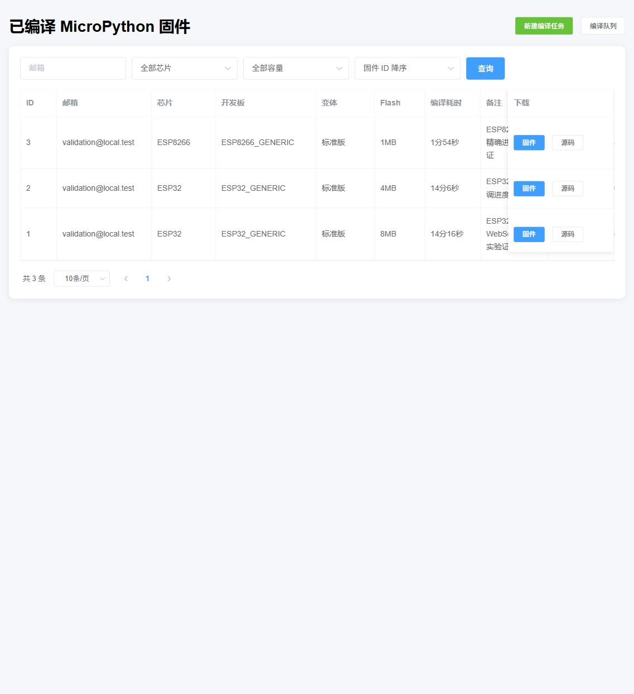

# compile-mpy-firmware

一个运行在树莓派 ARM64 上的 MicroPython 固件 Web 编译平台，支持上传 Python 文件、选择真实存在的开发板与 Flash 容量，并通过 WebSocket 实时显示精确编译进度。



## 已实现功能

- ESP8266、ESP32、ESP32-S2、ESP32-S3、ESP32-C3（以当前 MicroPython 源码树为准）。
- 自动扫描 `ports/esp8266/boards` 和 `ports/esp32/boards`，页面不再展示当前环境无法编译的假设备。
- ESP8266 的 512KB、1MB、2MB 选项会转换成真实的 `BOARD_VARIANT`。
- ESP32 系列的 2MB、4MB、8MB、16MB 选项会生成真实 `sdkconfig` 和对应分区表；`AUTO` 使用开发板默认值。
- 支持开发板自带的 SPIRAM、OTA、Octal-SPIRAM 等变体，并为已验证的 ESP32_GENERIC_C3 提供真实的 4MiB OTA 扩展配置。
- WebSocket 实时进度：ESP32 读取 Ninja 的 `[当前/总数]`，ESP8266 先用 `make -n` 计算真实步骤总数再逐步计数。
- SQLite 持久化任务进度，浏览器刷新、列表定时重载或 WebSocket 短暂断开后可以恢复。
- Web 内置 OTA 小白教程、带中文注释的完整更新代码、应用镜像 manifest 和安全下载接口。
- Docker Compose 一键部署，数据、日志、上传文件和固件都保存在宿主机。

## 零基础快速开始（树莓派 ARM64）

```bash
mkdir -p /data/compile-mpy-docker
cd /data/compile-mpy-docker
curl -O https://raw.githubusercontent.com/leiyong711/compile-mpy-firmware/leo/docker-compose.yml
docker compose pull
docker compose up -d
docker compose ps
```

然后访问 `http://树莓派IP:9001/`。本次部署的访问地址是：

```text
http://192.168.0.106:9001/
```

> 当前镜像为 `linux/arm64`，适用于 64 位树莓派系统。第一次拉取镜像较大，请耐心等待。

## 文档

- [树莓派手把手部署与验证教程](docs/树莓派手把手部署与验证教程.md)
- [Docker 一键部署教程](docs/Docker一键部署教程.md)
- [设备、开发板、变体与 Flash 参数说明](docs/设备与编译参数说明.md)
- [ESP32 / ESP32-C3 OTA 无线更新完整教程](docs/OTA无线更新完整教程.md)
- Web 小白教程：运行服务后打开 `/help/variants`，了解 SPIRAM、Octal-SPIRAM 和 OTA 完整流程
- [实机验证报告](docs/实机验证报告.md)

## 本地开发测试

```bash
python -m unittest discover -s tests -p "test_*.py" -v
python tests/firmware_smoke.py
```

生产环境只启动一个 Gunicorn worker，因为编译队列调度器运行在 Web 进程内；增加 worker 会重复启动调度器。
