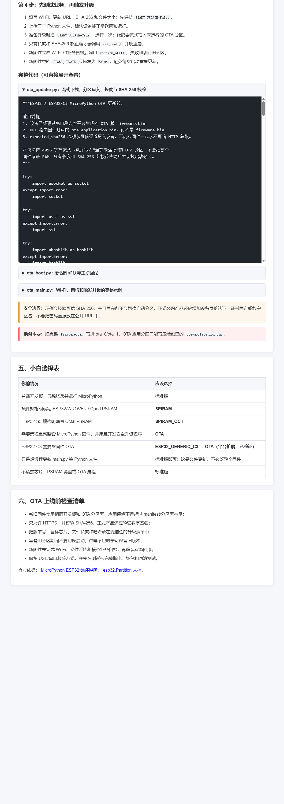

# ESP32 / ESP32-C3 MicroPython OTA 无线更新完整教程

Web 页面已经可以直接展开阅读完整源码，深色代码区使用高对比度文字；三个示例文件也可以单独下载：



这份教程面向第一次接触 OTA 的用户。目标是做到：第一次用 USB/串口安装 OTA 固件，以后设备通过网络下载新应用镜像，校验成功后切换启动；新版本启动失败时仍可回到旧版本。

## 1. OTA 不是什么

选择 OTA 变体不会自动得到一个云端升级平台，也不会自动把固件推送到设备。它只完成两件基础工作：

1. 使用 `ota_0`、`ota_1` 双应用分区；
2. 让 MicroPython 提供 `Partition.get_next_update()`、`set_boot()` 和回滚确认能力。

网络下载、版本策略、身份认证、哈希/签名验证和业务自检由设备端代码负责。本项目在 `static/examples/` 提供了带中文注释的完整示例。

## 2. 为什么 ESP32-C3 以前没有 OTA 选项

当前编译环境使用 MicroPython v1.22.2。它的 `ESP32_GENERIC/board.json` 声明了 OTA 变体，但 `ESP32_GENERIC_C3/board.json` 没有声明，所以原来的“只展示上游真实 variant”逻辑不会显示 C3 OTA。

这不代表 ESP32-C3 硬件不支持 OTA。ESP32-C3 和 ESP-IDF 支持双应用分区。本项目现在只对已验证的 `ESP32_GENERIC_C3` 增加“OTA（平台扩展，已验证）”：编译时复制上游 C3 板配置，生成独立的 `WEB_ESP32_GENERIC_C3_OTA`，加入 4MiB OTA 分区和体积优化配置，不会修改或冒充上游标准板。

C3 固件比普通 ESP32 OTA 应用略大，因此不能照抄普通 ESP32 的 0x180000 分区。本平台给 C3 的 `ota_0`、`ota_1` 各分配 0x1A0000（1,703,936）字节，VFS 保留 0x0B0000（704KiB）。打包前会读取实际 CSV 分区表并硬性检查应用大小，超限就判失败，不会再生成“编译成功但无法写入”的假可用包。

平台对普通 ESP32 OTA 和 C3 OTA 都会显式加入 `CONFIG_BOOTLOADER_APP_ROLLBACK_ENABLE=y`。因此新固件第一次启动会进入“等待确认”状态：业务自检成功后确认；在确认前崩溃或再次重启，bootloader 才能真正自动回到旧应用。只写两块 OTA 分区而不启用这个开关，并不等于拥有自动回滚。

## 3. 准备工作

- 一块 ESP32 或 ESP32-C3 开发板；
- 4MB 或更大的 Flash；
- 稳定电源和 USB 数据线；
- 电脑已安装 Python 和 `esptool`；
- 设备能访问固件服务器；
- 首次实验务必保留串口救砖方式。

安装烧录工具：

```bash
python -m pip install esptool
```

## 4. 第一次编译与串口烧录

编译页面选择：

| 芯片 | 开发板 | 变体 | Flash |
| --- | --- | --- | --- |
| ESP32 | ESP32_GENERIC | OTA | 自动/开发板默认 |
| ESP32-C3 | ESP32_GENERIC_C3 | OTA（平台扩展，已验证） | 自动/开发板默认 |

编译完成后下载 `firmware-ota-package.zip`：

```text
firmware-ota-package.zip
├── firmware.bin          # 第一次串口烧录用的完整镜像
├── ota-application.bin   # 以后通过网络写入备用分区
└── OTA流程说明.txt
```

Windows 烧录示例，把 `COM3` 换成实际端口：

```bash
# 普通 ESP32
python -m esptool --chip esp32 --port COM3 erase_flash
python -m esptool --chip esp32 --port COM3 --baud 460800 write_flash -z 0x1000 firmware.bin

# ESP32-C3
python -m esptool --chip esp32c3 --port COM3 erase_flash
python -m esptool --chip esp32c3 --port COM3 --baud 460800 write_flash -z 0x0 firmware.bin
```

首次必须烧录完整 `firmware.bin`，因为旧设备上还没有 OTA 分区表。不要把完整镜像写进 `ota_0` 或 `ota_1`。

## 5. 准备设备端代码

从 Web 教程页面下载：

| 文件 | 作用 |
| --- | --- |
| `ota_updater.py` | HTTP(S) 流式下载、写备用分区、校验长度和 SHA-256、切换启动 |
| `ota_boot.py` | 判断是否等待确认、确认新固件、主动回滚旧分区 |
| `ota_main.py` | Wi-Fi、业务自检和触发更新的完整示例；上传时改名为 `main.py` |

文件地址：

```text
http://树莓派IP:9001/static/examples/ota_updater.py
http://树莓派IP:9001/static/examples/ota_boot.py
http://树莓派IP:9001/static/examples/ota_main.py
```

先修改 `ota_main.py`：

```python
WIFI_SSID = "你的WiFi"
WIFI_PASSWORD = "你的密码"
FIRMWARE_URL = "http://树莓派IP:9001/api/ota/固件ID/application.bin"
EXPECTED_SHA256 = "manifest 返回的 64 位 SHA-256"
EXPECTED_SIZE = 1484112  # 以实际 manifest 为准
SELF_TEST_HOST = "192.168.0.106"  # 设备实际依赖的局域网服务
SELF_TEST_PORT = 9001
START_UPDATE = False
```

第一次先保持 `START_UPDATE=False`，确认联网、传感器和原有业务都正常。准备升级的那一次才改为 `True`。

## 6. 获取 OTA 下载信息

“已编译固件”页面中，OTA 记录会出现“OTA 信息”按钮。也可以直接打开：

```text
GET /api/ota/固件ID/manifest
```

示例响应：

```json
{
  "code": 2000,
  "data": {
    "size": 1484112,
    "sha256": "64位十六进制哈希",
    "download_path": "/api/ota/4/application.bin"
  }
}
```

设备端必须直接下载：

```text
GET /api/ota/固件ID/application.bin
```

这里返回的是 `ota-application.bin`，不是完整固件包。

## 7. 设备端实际执行过程

`ota_updater.install()` 会按以下顺序执行：

1. 获取当前运行分区；
2. `get_next_update()` 找到未运行的备用分区；
3. 检查 HTTP `Content-Length`、可信文件大小和目标分区容量；
4. 每次下载 4096 字节，边下载边计算 SHA-256；
5. 每一块写入备用分区，最后不足 4096 字节的部分用 `0xFF` 补齐；
6. 检查 ESP32 应用镜像头、总长度和 SHA-256；
7. 全部正确后才调用 `set_boot()`；
8. 使用 `machine.reset()` 硬重启，不能用 deepsleep 代替；
9. 新固件完成 Wi-Fi、配置、传感器和业务自检；
10. 自检成功调用 `confirm_ota()`；自检失败调用 `rollback_to_previous()`。

写入过程中断电只会破坏备用分区，因为 `set_boot()` 尚未执行，旧固件仍可启动。哈希不一致时也不会切换启动分区。

## 8. 为什么 SHA-256 必须可信

如果固件和 SHA-256 都从同一个不可信 HTTP 地址下载，攻击者可以同时替换两者。示例要求把预期 SHA-256 写入当前可信固件或从已认证渠道取得。

局域网测试可以先使用 HTTP + 可信 SHA-256。正式产品至少还应增加：

- HTTPS 证书校验或证书固定；
- 固件数字签名和设备端公钥验签；
- 设备身份认证和短期下载令牌；
- 防降级版本号；
- 分批发布和失败率监控。

## 9. 常见错误

### 提示“首字节不是 0xE9”

下载 URL 指向了 ZIP 或完整 `firmware.bin`。必须使用 `/api/ota/ID/application.bin`。

### 提示镜像放不进目标分区

冻结模块太多，应用超过当前板型 OTA 分区容量。普通 ESP32 默认每个应用区 0x180000；C3 平台扩展是 0x1A0000。删除不必要模块、资源或调试功能后重新编译；平台也会在打包前阻止超限镜像。

### 升级后反复回滚

新固件没有在完成核心自检后调用 `confirm_ota()`，或业务启动异常。检查串口日志，不要为了绕过回滚而在启动第一行立即确认。

### Web 表格进度不动但 WebSocket 有消息

旧页面定时刷新时替换了 Vue 表格行对象，WebSocket 仍在更新旧对象。新版本改为按任务 ID 保存响应式进度，并增加 5 秒 API 轮询兜底和 1.5 秒断线重连。

## 10. 官方参考

- [MicroPython ESP32 构建说明](https://github.com/micropython/micropython/blob/v1.22.2/ports/esp32/README.md)
- [MicroPython esp32.Partition](https://docs.micropython.org/en/v1.22.0/library/esp32.html#flash-partitions)
- [ESP32-C3 官方烧录说明](https://github.com/micropython/micropython/blob/v1.22.2/ports/esp32/boards/deploy_c3.md)

