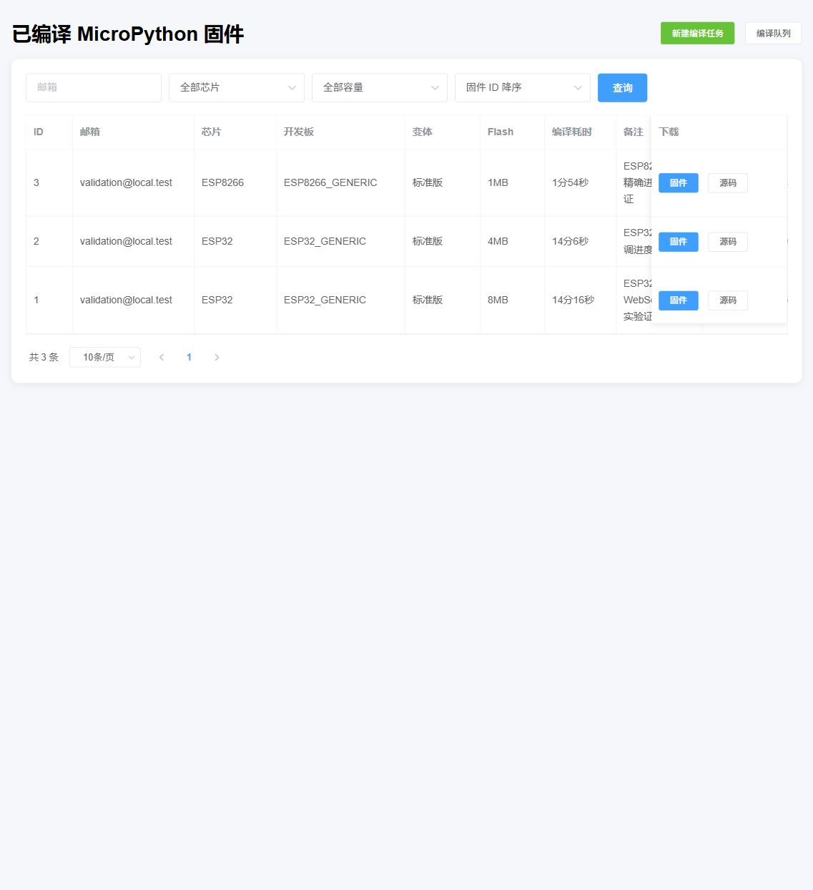
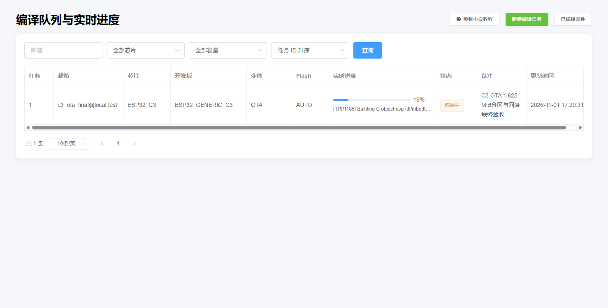

# 实机验证报告

验证日期：2026-10-31 至 2026-11-01（Asia/Shanghai）

验证设备：树莓派 ARM64，Debian 11

服务地址：`http://192.168.0.106:9001/`

## 自动化测试

- 设备发现、旧值兼容、Flash/变体校验：通过；
- ESP32 Ninja 进度解析及嵌套 bootloader 防倒退：通过；
- ESP8266 Make 步骤统计：通过；
- FastAPI 导入、SQLite 旧库字段迁移、接口冒烟测试：通过；
- Nginx 配置检查、外部 HTTP 访问、WebSocket 升级：通过；
- 已移除接口 `/api/test`：返回 403。

## 真实固件编译

| 芯片 | 开发板 | Flash | 实际步骤 | 结果 | 固件大小 | SHA-256 |
| --- | --- | --- | ---: | --- | ---: | --- |
| ESP32 | ESP32_GENERIC | 8MB | Ninja 1221 | 成功 | 1,738,112 字节 | `c705b1316e21382bb57cea17438471d588de5631be3ad4966b2f02ab85ef1eb7` |
| ESP32 | ESP32_GENERIC | 4MB | Ninja 动态总数 | 成功，89 次更新且单调不回退 | — | — |
| ESP8266 | ESP8266_GENERIC | 1MB | Make 282 | 成功，89 次更新 | 603,768 字节 | `9a1a8d214726997cd382c8347ea2125681c4dc5d133a6c50326acb53c6199882` |

早期验收只检查了生成板中的配置文件，后来发现部分上游板的 CMake 不会自动加载后来新增的 `sdkconfig.board`。最终版本改为显式把 `sdkconfig.web` 追加到 `SDKCONFIG_DEFAULTS` 的最后，并以构建目录中的最终合并 `sdkconfig` 为准；因此不再把“源配置文件存在”误当作“参数已经进入构建”。

修复后对 `WEB_ESP32_GENERIC_8M` 执行真实 ESP-IDF `reconfigure`，最终合并 `sdkconfig` 已确认包含 `CONFIG_ESPTOOLPY_FLASHSIZE="8MB"`、`partitions-8MiB.csv`，证明 Flash 参数现在确实进入 CMake/ESP-IDF。

## 页面记录

页面中的三条记录分别对应上述真实编译任务。编译完成后可以直接下载固件和打包源码。

## Docker 镜像隔离验证

最终应用镜像在 `127.0.0.1:9102` 隔离启动，没有复用原生服务的数据库或构建目录：

- 容器健康检查：`healthy`；
- `/api/build-options`：5 个芯片系列、22 个真实开发板；
- ESP-IDF：v5.0.4；
- ESP8266：`ESP8266_GENERIC`、1MB，预扫描 282 个 Make 动作；
- WebSocket：79 次进度更新，单调递增，最终 `100% / success`；
- 容器生成固件：603,584 字节；
- 固件 SHA-256：`4d819cb67df8b73997e7bafcfbb94a35f20299b3e68a2d079467140c4e43d3fd`。

验证过程中专门检查了失败状态：进度达到 100% 但状态为 `failed` 不算通过，只有最终状态为 `success` 才通过断言。

## OTA 变体与下载包验证

2026-11-01 在原生服务中真实编译 `ESP32_GENERIC + OTA + AUTO`：

- ESP-IDF/Ninja 实际步骤：1,222，最终状态 `100% / success`；
- 下载接口返回 `firmware-ota-package.zip`，HTTP 200；
- `firmware.bin`：1,545,552 字节，SHA-256 `2b67874ae4bd071d4355a2be7820bf4309afff1e0ec22880213313acd84f9537`；
- `ota-application.bin`：1,484,112 字节，SHA-256 `bb581324004188d978fa78ef1b0f61c25bdad683091119fcd3ec8152e43b358e`；
- `OTA流程说明.txt`：存在，并包含禁止把完整固件写入 OTA 应用分区的提示；
- OTA 应用分区容量为 0x180000（1,572,864）字节，应用镜像尚余 88,752 字节，通过容量校验；
- `/help/variants`、编译页标准版提示和 OTA 黄色警告均已通过真实浏览器视觉检查。

## 队列同步与 C3 OTA 验证

2026-11-01 使用真实 Chrome 页面和真实 C3 编译任务复现并验证列表同步：页面先显示 `19% / [119/1185]`，等待 12 秒、跨过至少两次 5 秒列表重载后继续显示 `22% / [161/1185]`。这证明新任务对象替换后 WebSocket/响应式进度仍持续更新，没有再停在旧百分比。页面同时保留 `/api/progress/{任务ID}` 轮询作为断线兜底。

截图是 C3 OTA 进度验收任务的真实编译过程，不是静态演示数据。该轮随后用于继续检查分区配置；最终有效固件、分区表和回滚配置结果见本节后续记录。

最终 `ESP32_GENERIC_C3 + OTA + AUTO` 全量编译结果：

- Ninja 实际总步骤：1,186；最终 `100% / success`；耗时 654,577ms；
- 最终合并 `sdkconfig`：4MB Flash、`partitions-4MiB-ota-c3.csv`、体积优化和 `CONFIG_BOOTLOADER_APP_ROLLBACK_ENABLE=y` 均已生效；
- 从构建产物 `partition-table.bin` 反解析：`ota_0=1664KiB`、`ota_1=1664KiB`、`vfs=704KiB`；
- `firmware.bin`：1,460,288 字节，SHA-256 `ddef51bbb35b95a51ce1ef90758789979ead7a79e5e87f399aab843a86f15461`；
- `ota-application.bin`：1,394,752 字节，SHA-256 `077ddfe9466612f1759b16edd9828dffc7de928c6a28ade55833b8e87ec2a4cf`；
- 单个 OTA 应用分区为 1,703,936 字节，剩余 309,184 字节；打包前容量硬检查通过；
- manifest、下载响应 `Content-Length`、`X-OTA-SHA256` 和实际下载文件全部一致；
- 恢复后的有效 OTA 固件记录 ID 为 `6`，接口为 `/api/ota/6/manifest`。

原生服务的数据已迁移到 `/data/compile-mpy-runtime`，systemd 设置了 `COMPILE_MPY_DATA_DIR`；数据库、上传文件和固件从此与项目代码目录隔离，并保留了恢复前、恢复后的 SQLite 备份。

## Docker v2.2.0 发布验证

2026-11-01 在树莓派上构建并隔离启动 `leiyong711/compile-mpy-firmware:v2.2.0-arm64`：

- 容器状态为 `running / healthy`，HTTP 页面和 C3 OTA 变体正常；
- 容器内自动化测试 18/18 全部通过；
- OTA 示例代码可从帮助页下载，代码显示样式已经真实浏览器检查；
- 已发布 `v2.2.0-arm64`、`latest-arm64`、`latest` 三个标签；
- 应用镜像摘要：`sha256:1b6615817c2b70077b3b7c900cf2009defef7c25691a3ea18904ea9d480b0c0a`；
- `latest` 远程清单已确认为 `linux/arm64/v8`，并引用上述固定版本摘要。
