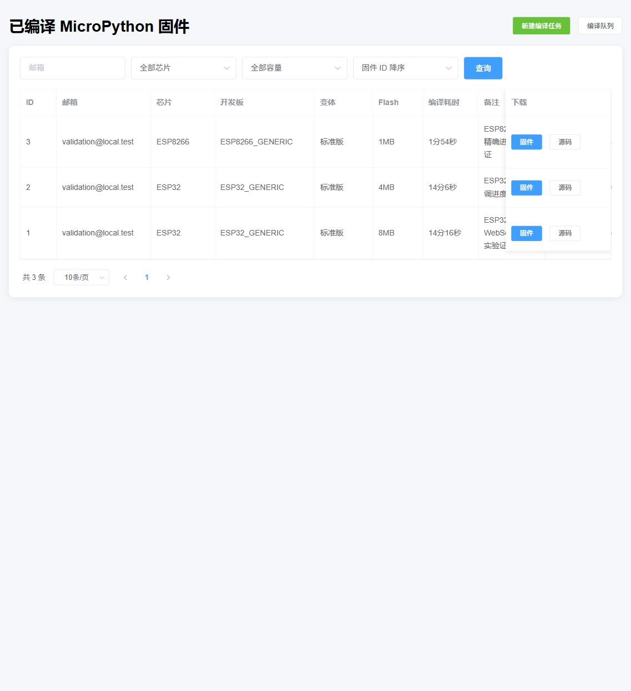
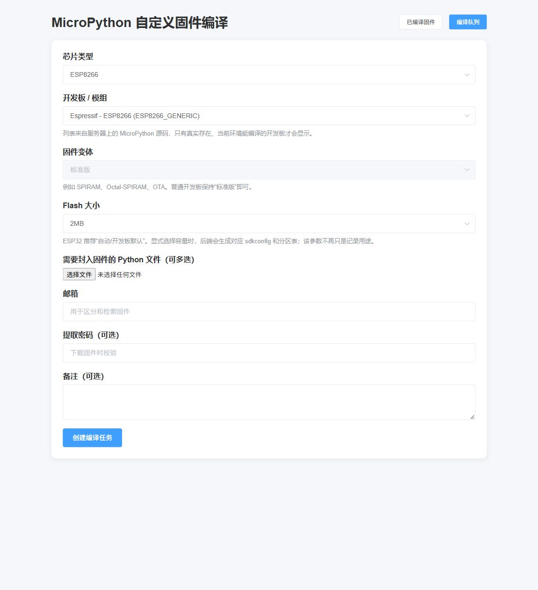
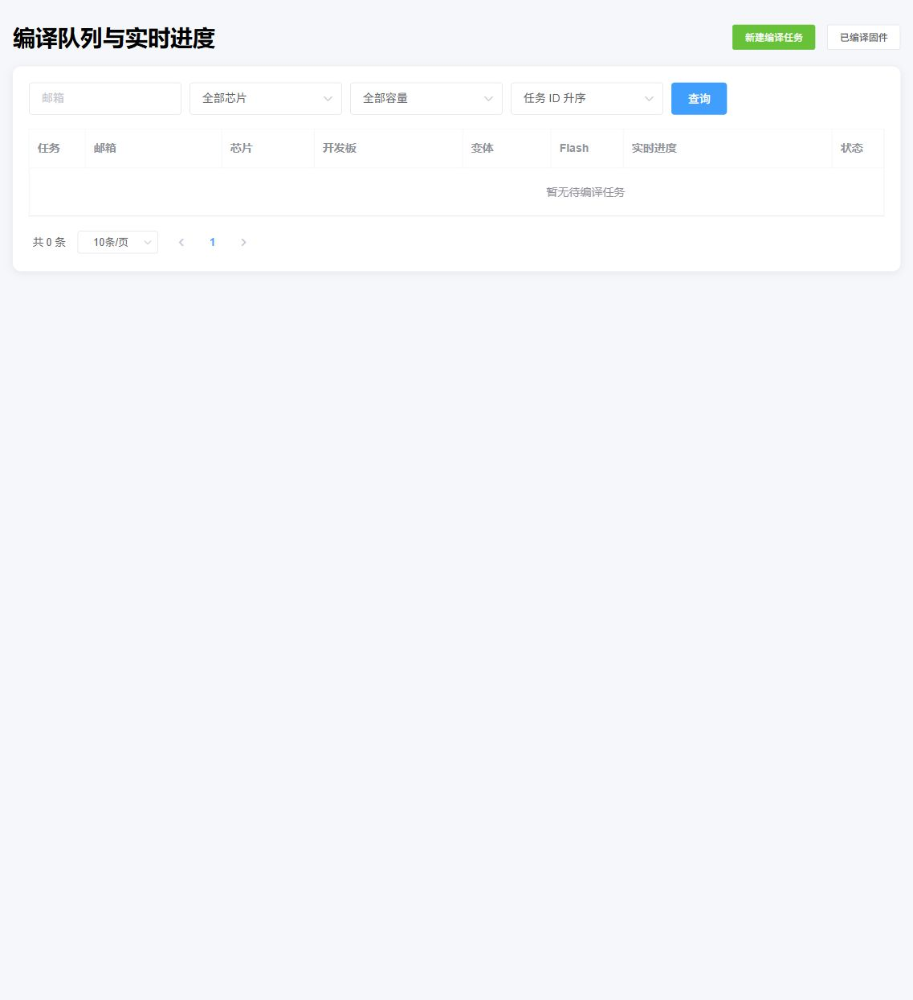

# 树莓派手把手部署与验证教程

本文面向第一次使用 Linux、Docker 和 MicroPython 编译环境的读者。推荐使用 Docker 方案：工具链、源码和 Python 依赖都已经封装好，不需要手动处理 ESP-IDF 与交叉编译器版本。

## 1. 本次已部署环境

| 项目 | 值 |
| --- | --- |
| 树莓派地址 | `192.168.0.106` |
| 系统 | Debian 11，ARM64 |
| Web 地址 | `http://192.168.0.106:9001/` |
| 项目目录 | `/data/compile-mpy-firmware` |
| MicroPython | v1.22.2 |
| ESP-IDF | v5.0.4 |
| 原生服务 | `compile-mpy-firmware.service` |
| 容器架构 | `linux/arm64` |

文档不会记录登录密码。密码应只在 SSH 提示符中输入，不要复制到脚本、Git 仓库或截图里。

## 2. 准备树莓派

### 2.1 确认是 64 位系统

用 SSH 登录树莓派后执行：

```bash
uname -m
cat /etc/os-release
```

`uname -m` 应输出 `aarch64`。如果是 `armv7l`，当前 ARM64 镜像不能直接运行，需要重装 64 位 Raspberry Pi OS/Debian。

### 2.2 检查磁盘和内存

```bash
df -h /
free -h
```

建议至少保留 12GB 可用磁盘空间和 2GB 内存。ESP32 首次编译时间较长，树莓派 4/5 建议把 `BUILD_JOBS` 设为 4；内存较小的型号可改成 2。

### 2.3 安装 Docker

如果已经能运行 `docker version`，跳过此节。

```bash
apt-get update
apt-get install -y ca-certificates curl docker.io docker-compose-plugin
systemctl enable --now docker
docker version
docker compose version
```

若系统仓库没有 `docker-compose-plugin`，可以安装 `docker-compose`，随后把文档中的 `docker compose` 换成 `docker-compose`。

## 3. 推荐方案：Docker 一键部署

```bash
mkdir -p /data/compile-mpy-docker
cd /data/compile-mpy-docker
curl -O https://raw.githubusercontent.com/leiyong711/compile-mpy-firmware/leo/docker-compose.yml
docker compose pull
docker compose up -d
```

查看状态：

```bash
docker compose ps
docker compose logs --tail=100
curl -I http://127.0.0.1:9001/
```

看到容器状态为 `running`/`healthy`，并且 `curl` 返回 `HTTP/1.1 200 OK`，说明服务已启动。

数据目录是当前目录下的 `data/`：删除或升级容器不会删除数据库、日志、上传文件和已编译固件。

## 4. 打开 Web 页面

在与树莓派同一局域网的电脑浏览器中打开：

```text
http://192.168.0.106:9001/
```

已编译固件页如下。每一行都会保存芯片、开发板、变体、Flash、编译耗时和备注。



点击“新建编译任务”进入表单：



## 5. 创建第一个编译任务

建议先使用耗时较短的 ESP8266 做入门验证：

1. 芯片类型选 `ESP8266`。
2. 开发板选 `ESP8266_GENERIC`。
3. Flash 选 `1MB`。
4. 先在电脑上新建 `main.py`，内容可以只有 `print("hello")`，然后在“选择文件”中选它。当前页面要求至少上传一个文件。
5. 邮箱填写一个用于区分任务的有效格式地址；当前系统不发送邮件。
6. 备注填写“第一次验证”。
7. 点击“创建编译任务”。

任务提交后页面会展示任务编号并连接 WebSocket。点击“编译队列”可以随时查看状态：



编译过程中“实时进度”会依次显示：等待、准备源码、编译 mpy-cross、计算步骤、编译固件、打包、完成。刷新页面不会丢失进度。

## 6. 验证 Flash 参数确实生效

页面参数不是只写入数据库：

- ESP8266 512KB 对应 `BOARD_VARIANT=FLASH_512K`。
- ESP8266 1MB 对应 `BOARD_VARIANT=FLASH_1M`。
- ESP8266 2MB 使用标准版。
- ESP32 系列选 2/4/8/16MB 时，会创建 `WEB_开发板_容量`，并写入 `CONFIG_ESPTOOLPY_FLASHSIZE` 和 `partitions-*MiB.csv`。
- ESP32 系列选 `AUTO` 时，保持开发板源码自带的默认容量和分区表。

可以在容器内查看 8MB 示例：

```bash
docker exec compile-mpy-firmware sh -lc \
  "grep -E 'FLASHSIZE|PARTITION_TABLE' /opt/micropython/ports/esp32/boards/WEB_ESP32_GENERIC_8M/sdkconfig.board"
```

预期能看到 `CONFIG_ESPTOOLPY_FLASHSIZE_8MB=y` 和 `partitions-8MiB.csv`。

## 7. 日常维护

查看日志：

```bash
cd /data/compile-mpy-docker
docker compose logs -f --tail=100
```

重启：

```bash
docker compose restart
```

升级：

```bash
docker compose pull
docker compose up -d
```

停止但保留数据：

```bash
docker compose down
```

备份：

```bash
tar -czf compile-mpy-backup-$(date +%F).tar.gz -C /data/compile-mpy-docker data
```

## 8. 当前树莓派上的原生 systemd 部署

本次实机还保留了一套不依赖容器运行的原生服务，用于交叉验证：

```bash
systemctl status compile-mpy-firmware --no-pager
curl -fsS http://127.0.0.1:9101/api/build-options
nginx -t
```

关键目录：

```text
/data/compile-mpy-firmware          Web 项目和 Python 虚拟环境
/data/micropython/micropython      MicroPython v1.22.2 源码
/opt/esp-idf-v5.0.4                ESP-IDF v5.0.4
/root/.espressif                    ESP-IDF 下载的 ARM64 工具链
/opt/esp-open-sdk                  ESP8266 SDK/sysroot
```

原生服务修改代码后执行：

```bash
cd /data/compile-mpy-firmware
venv/bin/python -m unittest discover -s tests -p 'test_*.py' -v
systemctl restart compile-mpy-firmware
systemctl status compile-mpy-firmware --no-pager
```

Nginx 代理 WebSocket 时必须包含：

```nginx
proxy_http_version 1.1;
proxy_set_header Upgrade $http_upgrade;
proxy_set_header Connection "upgrade";
```

## 9. 常见问题

### 页面打不开

```bash
ss -lntp | grep 9001
docker compose ps
curl -v http://127.0.0.1:9001/
```

如果本机能访问、其他电脑不能访问，检查树莓派防火墙和路由器的客户端隔离设置。不要把此编译页面直接暴露到公网；当前版本没有用户登录鉴权。

### 进度不更新

按 `F12` 查看浏览器控制台，再检查反向代理是否转发了 `Upgrade` 和 `Connection` 请求头。前端在 WebSocket 断线时会自动降级到 HTTP 轮询，因此任务不会停止。

### 编译很慢

第一次编译会生成大量中间文件，ESP32 在树莓派上约需十几分钟；之后通常会受缓存影响而更快。不要把 Gunicorn worker 数量改成多个，否则会重复启动编译调度器。

### 选择变体后不能再指定 Flash

开发板变体往往已经带自己的 `sdkconfig`。为避免两套配置互相覆盖，选择 SPIRAM/OTA 等变体时必须把 Flash 设为 `AUTO`。
