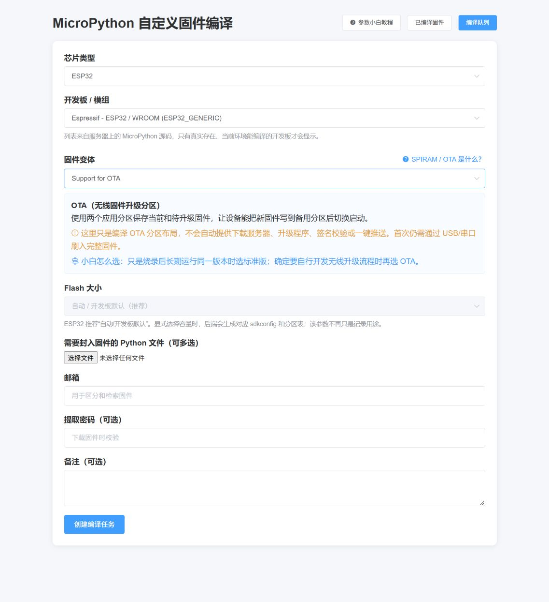

# 设备、开发板、变体与 Flash 参数说明

## 1. 为什么不再在页面中写死设备列表

旧页面把设备和 Flash 选项写死，并存在三个问题：

1. `ESP32_S` 不是 MicroPython 的有效芯片系列名称；
2. 前端发送 `2MB/4MB`，旧过滤逻辑却使用 `2M/4M`；
3. Flash 值只保存到数据库，没有传给 `make`、sdkconfig 或分区表。

现在后端读取当前 MicroPython 源码中的 `board.json`，按 `mcu` 字段分组，前端通过 `/api/build-options` 动态加载。只有源码树中真实存在的目标才会显示。

## 2. 当前环境可用芯片

MicroPython v1.22.2 实机扫描结果包含：

- ESP8266
- ESP32
- ESP32-S2
- ESP32-S3
- ESP32-C3

代码已经识别 ESP32-C2/C5/C6/H2/P4 的 `mcu` 名称；升级到包含相应 `board.json` 的 MicroPython 源码后，它们会自动出现在页面，不会在当前旧源码上显示无法编译的假选项。

## 3. 参数如何应用

```text
页面选择
  ├─ 芯片类型 ──> 校验开发板 board.json 的 mcu
  ├─ 开发板 ────> make BOARD=...
  ├─ 开发板变体 ─> make BOARD_VARIANT=...
  └─ Flash
       ├─ ESP8266 ─> FLASH_512K / FLASH_1M / 标准版
       └─ ESP32 ───> 自动，或生成 WEB_* 开发板 + sdkconfig + 分区表
```

### ESP8266

| 页面值 | 实际 make 参数 |
| --- | --- |
| `512KB` | `BOARD_VARIANT=FLASH_512K` |
| `1MB` | `BOARD_VARIANT=FLASH_1M` |
| `2MB` | 标准开发板，不附加变体 |

### ESP32 系列

| 页面值 | 实际行为 |
| --- | --- |
| `AUTO` | 使用开发板自带 sdkconfig 与分区表 |
| `2MB` | 生成 `WEB_*_2M`，写入 2MB sdkconfig 和 `partitions-2MiB.csv` |
| `4MB` | 生成 `WEB_*_4M`，写入 4MB sdkconfig 和 `partitions-4MiB.csv` |
| `8MB` | 生成 `WEB_*_8M`，写入 8MB sdkconfig 和 `partitions-8MiB.csv` |
| `16MB` | 生成 `WEB_*_16M`，写入 16MB sdkconfig 和 `partitions-16MiB.csv` |

显式容量会覆盖：

```text
CONFIG_ESPTOOLPY_FLASHSIZE_*MB
CONFIG_ESPTOOLPY_FLASHSIZE
CONFIG_PARTITION_TABLE_CUSTOM
CONFIG_PARTITION_TABLE_CUSTOM_FILENAME
CONFIG_PARTITION_TABLE_FILENAME
```

### 开发板变体

变体来自各开发板 `board.json` 的 `variants`，例如 SPIRAM、OTA、SPIRAM_OCT。变体本身可能带容量和分区配置，因此规则是：

- 标准版：可以选择 `AUTO` 或显式 Flash 容量；
- 非标准变体：Flash 必须选 `AUTO`；
- ESP8266 的容量已由 Flash 下拉框控制，不重复显示 `FLASH_512K/FLASH_1M` 变体。

### SPIRAM、Octal-SPIRAM 与 OTA

| 变体 | 实际含义 | 适用条件 |
| --- | --- | --- |
| `SPIRAM` | 启用 Quad-SPI 外部 PSRAM，扩大运行时堆；不会增加 Flash | 明确配备 PSRAM/WROVER 的 ESP32 |
| `SPIRAM_OCT` | 让 ESP32-S3 使用 Octal（八线）PSRAM 模式 | 硬件规格明确标注 Octal PSRAM |
| `OTA` | 使用 `ota_0`、`ota_1` 双应用分区，为无线整固件升级提供基础 | 需要自行实现下载、校验、切换和确认/回滚流程 |
| `D2WD` | 针对内部集成 2MB Flash 的 ESP32-D2WD | 芯片型号确实为 ESP32-D2WD |
| `UNICORE` | 只使用一个 CPU 核心 | 单核硬件或明确的兼容需求 |

不知道硬件规格时保持“标准版”。SPIRAM 是运行内存，不是存储固件的 Flash；OTA 也不是自动升级按钮。

Web 页面 `/help/variants` 提供面向初学者的完整说明和选择表。



## 4. OTA 完整流程

MicroPython v1.22.2 的 `ESP32_GENERIC + OTA` 使用 4MB OTA 分区表：

- `ota_0`：约 1.5MiB，保存一个应用固件；
- `ota_1`：约 1.5MiB，保存另一个应用固件；
- `otadata`：保存 bootloader 下一次启动哪个应用分区；
- `vfs`：约 960KiB，保存设备文件系统。

设备从 `ota_0` 运行时，新固件写入 `ota_1`；写入和 SHA-256/签名校验全部通过后调用 `set_boot()`，硬重启进入新分区。新固件完成自检后调用 `Partition.mark_app_valid_cancel_rollback()`；没有确认或启动失败时由 bootloader 回滚。

本平台对 OTA 编译任务提供 `firmware-ota-package.zip`：

- `firmware.bin`：首次 USB/串口安装使用，包含 bootloader、分区表和应用；
- `ota-application.bin`：后续网络更新写入备用 OTA 应用分区；
- `OTA流程说明.txt`：包内注意事项。

不要把完整的 `firmware.bin` 写入 `ota_0` 或 `ota_1`。选择 OTA 只建立升级所需的固件和分区基础，不会自动提供服务器、网络下载、设备身份认证或签名密钥管理。

## 5. 后端校验

提交任务时，后端会再次校验，不信任浏览器传来的值：

- 芯片必须存在于当前源码；
- 开发板必须属于所选芯片；
- 变体必须存在于该开发板 `board.json`；
- Flash 必须在该芯片允许范围内；
- 变体和显式 Flash 不允许冲突；
- 兼容旧记录的 `ESP32_S`、空格分隔芯片名和 `2M/4M` 格式。

## 6. 精确实时进度算法

ESP32/ESP-IDF 使用 Ninja，输出包含 `[当前步骤/总步骤]`。解析器会：

- 取最大总步骤，忽略嵌套 bootloader 的较小总数；
- 只允许进度单调增加，永不倒退；
- 为准备、mpy-cross、打包保留独立进度区间；
- 将最新状态持久化到 SQLite，并通过 WebSocket 推送。

ESP8266 Makefile 没有总进度。系统先运行同参数的 `make -n`，精确统计 CC、CXX、AS、LINK、GEN、Create 等真实动作，再执行正式 `make` 并逐项计数。

WebSocket 断开时前端会重连，并用 `/api/progress/{task_id}` 轮询补偿。编译进程本身不依赖浏览器连接。

## 7. API

| 地址 | 说明 |
| --- | --- |
| `GET /api/build-options` | 当前真实设备、开发板、变体、Flash 选项 |
| `GET /api/progress/{task_id}` | 获取任务最新进度 |
| `WS /api/ws/progress/{task_id}` | 实时进度推送 |
| `POST /api/upload` | 创建编译任务 |

任意命令执行测试接口已经移除，旧的 `/api/test` 不再可用。
